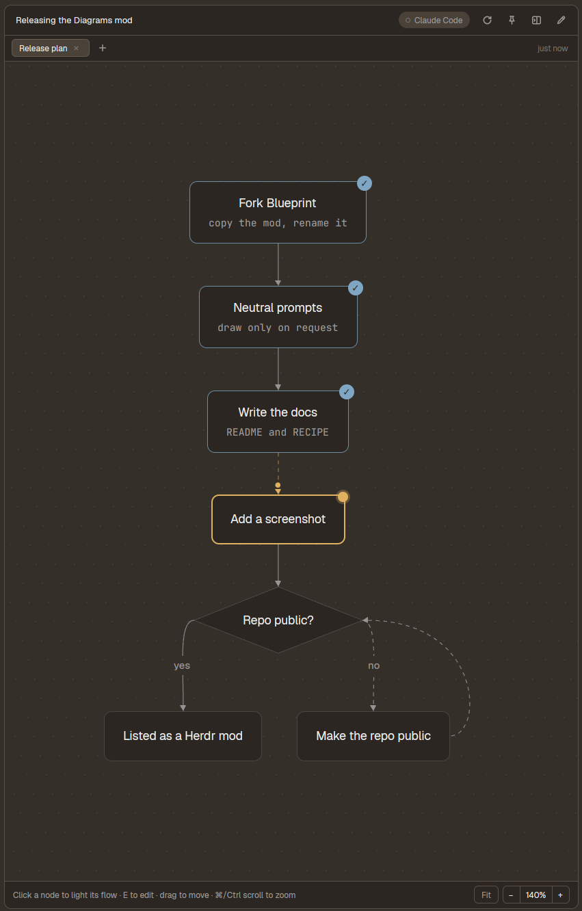

# Herdr Diagrams

A [Herdr app](https://herdr.dev) mod that draws the Mermaid flowcharts an agent makes when you ask for them: a session plan, a process, a data model, how parts fit together, or code.

It is a fork of [Blueprint](https://github.com/chappse6/herdr-blueprint-app) 0.3.6 (MIT). Blueprint asks a connected agent to draw the code it is working on; Diagrams draws whatever you ask for.



## How it differs from Blueprint

- Connecting an agent draws nothing. The agent is told the panel exists and to wait.
- You ask for a diagram with **+** (or the **New diagram** button in the empty view). The first suggestion is "The plan for this session".
- Boxes do not have to be code. `%% code: <id> <path>:<line>` is optional and only for boxes that stand for code.
- `class <ids> done|active|current` is used for plans and processes, not for diagrams that show how something is.
- Edit mode (`e`, click a box, write a note): a box with a code reference changes the code and then the diagram, as in Blueprint. Any other box changes only the diagram, and if the diagram is the plan the agent is following, the changed diagram becomes the plan.
- Diagrams are kept 30 days after last use (Blueprint: 7), at most 50 unpinned per project (Blueprint: 10). Pinned diagrams are never deleted.
- The update check reads `mods/diagrams/mod.json` in this repository (`REMOTE` in `mods/diagrams/update.js`), not Blueprint. Turn it off with `herdr-app do diagrams.update-check-off`.

Everything else (layout, pan and zoom, PNG export, tabs, pin, pane and panel placement, commands) is unchanged from Blueprint. PNG export is macOS only.

## What can be drawn

Only what `mermaid.js` parses, a flowchart subset:

- Shapes: `[rect]`, `(round)`, `([stadium])`, `[(cylinder)]`, `((circle))`, `{diamond}`
- Edges: `-->`, `---`, `-.->`, `-.-`, `==>`, with `|label|` or `-- label -->`
- `"Title<br/>subtitle"` splits a box into title and subtitle
- Frontmatter `title:` is the tab name
- `subgraph`, `classDef`, `style` and `linkStyle` are ignored, so boxes cannot be grouped

Sequence, class, gantt and other Mermaid diagram types are not rendered. The agent is told to draw the closest flowchart form and say so.

## Install

```sh
git clone https://github.com/petertornstrand/herdr-app-diagrams
cp -r herdr-app-diagrams/mods/diagrams ~/.config/herdr-app/mods/diagrams
herdr-app check ~/.config/herdr-app/mods/diagrams
```

Herdr reloads mods when their files change. Open it as a pane (`pane.split` with `mod: "diagrams"`), or add it as a side panel next to Files and Changes with a Diagrams pane open:

```sh
herdr-app do diagrams.add-button
```

`add-button` clones your `main` layout as `main-diagrams`. If you use a customized layout, add a block with `"mod": "diagrams"` and `"props": { "panel": true }` to it by hand instead (see `mods/diagrams/setup.js`). Remove the button again with `herdr-app do diagrams.remove-button`.

The mod is independent of Blueprint: panel id `diagrams`, data in `data/diagrams/`, shared key `diagrams.*`, layouts `main-diagrams` and `tabs-diagrams`. Both can be installed side by side.

## What it runs and reads

Mods are trusted code, so for the record:

- **Network:** one GET a day to `raw.githubusercontent.com` for `mods/diagrams/mod.json` in this repository (the update check), nothing sent but the request. `herdr-app do diagrams.update-check-off` stops it.
- **Programs it runs:** `hc send` (your requests to the connected agent), `git -C <folder> rev-parse --show-toplevel` (to find the project), and on macOS only `herdr-app shot`, `sips`, `osascript` and `rm` (PNG export).
- **Files outside its folder:** its own data in `data/diagrams/`, `~/.claude/settings.json` (read, to pick the language), and, for `add-button` only, `layouts/main-diagrams.json` and the cloned `mods/tabs-diagrams/main.js`.

See `RECIPE.md` for the full brief.

## Where things are stored

`~/.config/herdr-app/data/diagrams/projects/<name>-<hash>/` holds one folder per project (git checkout, so one per worktree) with the `.mmd` files, `project.json` and, if present, `topic.txt`. Nothing is written into your repositories.

## Where the behavior is defined

| What | Where |
| --- | --- |
| What the agent is told when connected | `drawPrompt` in `mods/diagrams/main.js` |
| What the agent is told for a new diagram | `newPrompt` in `main.js` |
| How diagrams are written (shapes, code refs, progress marks, updating) | `diagramRules` in `main.js` |
| What a click in edit mode sends | `pointPrompt` in `main.js` |
| The empty view and the connected state | `emptyCard` in `main.js` |
| Starting points for a new diagram | `suggest` in `i18n.js` (en, ko, ja) |
| Retention (30 days, 50 unpinned) | `KEEP_DAYS`, `KEEP_COUNT` in `store.js` |
| Supported syntax | `mermaid.js` |

## Following upstream

Diagrams does not follow Blueprint automatically. To take a change from Blueprint, read its commit history and port it by hand. `main.js`, `store.js`, `setup.js`, `update.js` and `i18n.js` differ from upstream in the places listed above; `layout.js` and `mermaid.js` do not.

## Updates

At most once a day the mod reads `version` in this repository's `mods/diagrams/mod.json` (one GET to `raw.githubusercontent.com`; nothing is sent but the request). If it is newer than the installed one, an **update** pill shows in the header. The pill asks the connected agent to read the new files and replace the mod, run `herdr-app check` and tell you what changed. Nothing is updated without an agent reading it first. To stop the daily check: `herdr-app do diagrams.update-check-off` (`update-check-on` brings it back).

## License

MIT. `LICENSE` keeps Blueprint's copyright notice, as MIT requires, and adds one for the changes in this fork.
