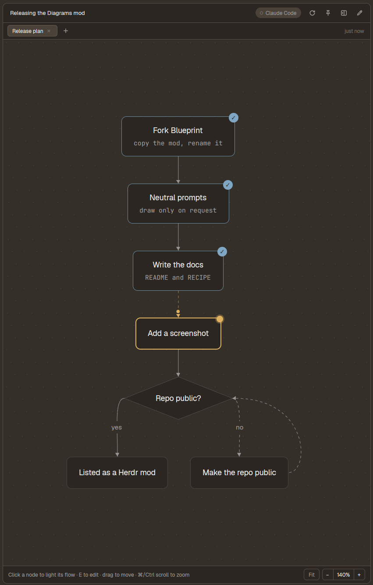

# Herdr Diagrams

A panel in the Herdr app that draws the Mermaid flowcharts a coding agent makes when you ask for them: the plan for a session, a process, a data model, how parts fit together, or code. One tab per diagram, redrawn live as the agent saves the file.

## What you see

The mod is one column (a side panel next to Files and Changes, or a pane), top to bottom:

- **Header, 44 px:** the project's topic line if the agent wrote one, else the project folder name, then the git branch in the mono font. At the right: a pill with the connected agent and its status mark, a refresh button, a pin button, an "open as pane" button (panel only) and an edit button. A small accent-colored "update" pill appears when `mod.json` in the repository has a higher version than the installed one.
- **Tab row, 38 px:** one tab per diagram (the diagram's `title:`), a **+** button after the last tab, and how long ago the shown diagram was saved at the far right. Tabs are as wide as their title, 72 to 200 px; a tab can be dragged to reorder, closed with ×, and a pinned one shows a pin.
- **Canvas:** the shown diagram, drawn natively from the parsed flowchart. Boxes are rects, rounded rects, stadiums, cylinders, circles or diamonds; edges are solid, dashed or thick, with optional labels. Color carries status only, from the theme's tokens: a box in progress has a yellow border and a yellow dot badge, with a yellow dot running along the edge that leads into it (only while the panel has focus); a finished box gets a blue check badge and a blue-tinted border; the rest are neutral. The canvas has a faint dot grid, and a diamond is a dark filled rhombus.
- **Footer, 40 px:** a hint (or the selected box's title and code reference), then a Fit button, a zoom control (−, percentage, +) and, on macOS only, a PNG button.
- **Empty view:** with no diagram yet, a centred card. With no agent connected it lists the agents in the tab to pick from; once one is connected it says so and shows a **New diagram** button.
- **Request box, 136 px, above the footer:** opens from + (a new diagram) or from a clicked box in edit mode. It has a text field, the target agent, and suggestion chips for a new diagram: "The plan for this session", "How the parts fit together", "A process step by step", "This in detail: ".

Texts come in English, Korean and Japanese (`i18n.js`).

## How it behaves

- **Connecting** an agent (clicking it in the empty view) sends it one message: the panel is connected, draw nothing yet, and here is how diagrams are written. Nothing is drawn until you ask.
- **Asking** (+ then a request, or a chip): the request goes to the connected agent with `hc send`. The agent saves a `.mmd` file in the project's folder under the app's data folder; the panel watches that folder and opens the new file as a tab.
- **Status:** the agent writes `class <ids> done|active|current` in plans and processes. `active` and `current` boxes are yellow; while the panel has focus a dot runs through the part being worked on (one per line of work), otherwise nothing moves, because a running dot keeps the window repainting.
- **Click a box:** its upstream and downstream flow stays lit, the rest dims.
- **Edit mode (`e`):** click a box, write a note, send. A box with a `%% code:` reference asks the agent to change the code, run the tests and update the diagram. Any other box asks it only to change the diagram, and if the diagram is the plan the agent follows, the changed diagram becomes the plan.
- **Moving:** drag or scroll to pan, Ctrl or Cmd plus scroll to zoom, Fit resets. The layout turns top-to-bottom when that fits the pane better.
- **Keeping:** diagrams are deleted after 30 days without use, and past a day old a project keeps at most 50 unpinned ones. Pinned diagrams are never deleted. Closing a tab hides a diagram without deleting it.
- **Projects:** one per git checkout of the tab's terminal, so each worktree has its own diagrams. Nothing is written into the repositories.

Commands (`herdr-app do diagrams.<name>` or in `keys.json`): `fit`, `zoom-in`, `zoom-out`, `zoom-100`, `export`, `clear`, `tab-1` to `tab-9`, `select-<node id>`, `edit`, `compose-<node id>`, `note-<text, _ for spaces>`, `send`, `cancel`, `target-<terminal>`, `connect-<terminal>`, `pin`, `pane`, `new`, `refresh`, `close-tab`, `add-button`, `remove-button`, `update-check-on`, `update-check-off`, `lang-<en|ko|ja>`.

## Built from

Plain JavaScript on Herdr's `gpui-kit` and `gpui-base`, no dependencies. `mod.json` is `{ "place": "none", "title": "Diagrams", "version": "1.0.0" }`.

| File | Does |
| --- | --- |
| `main.js` | the view, the prompts (`drawPrompt`, `newPrompt`, `diagramRules`, `pointPrompt`), commands |
| `mermaid.js` | parses the flowchart subset into nodes and edges, plus `class`, `%% code:`, `click` and frontmatter `title:` |
| `layout.js` | lays nodes and edges out, left-to-right or top-to-bottom |
| `store.js` | the per-project folder, `project.json`, retention, tab order |
| `setup.js` | `add-button` / `remove-button`: clones the `main` layout and the `tabs` mod and adds the panel |
| `update.js` | the daily update check |
| `i18n.js` | English, Korean, Japanese texts |

Herdr functions used: `theme`, `settings`, `agents`, `panes`, `spaces`, `focused`, `props`, `knownAgents`, `exec`, `hc`, `run`, `home`, `notify`, `readTextFile`, `watchFolder`, `nextCommand`, `shared`, `setShared`, `window`. Commands run: `hc send` (requests to the agent), `git -C <folder> rev-parse --show-toplevel` (the project), `herdr-app shot`, `sips`, `osascript` and `rm` (PNG export, macOS only), and `pane.split`, `pane.focus`, `layout.hide`, `layout.switch`, `mod.clone` (panel and pane handling).

Files read or written outside the mod's folder: the app's `data/diagrams/` (its own data), `~/.claude/settings.json` (read, to pick the language), and, for `add-button` only, `layouts/main-diagrams.json` and the cloned `mods/tabs-diagrams/main.js`. Network: one GET a day to `raw.githubusercontent.com/petertornstrand/herdr-app-diagrams/main/mods/diagrams/mod.json`, nothing sent but the request. `update-check-off` stops it.

## Watch out

- Only flowcharts are drawn. `subgraph`, `classDef`, `style` and `linkStyle` are skipped, so boxes cannot be grouped; sequence, class and gantt diagrams do not render.
- The PNG button exists on macOS only (`canExport`).
- A fresh build must not draw on connect. The original Blueprint does; here connecting sends a "wait" message and the diagram comes from a request.
- A connected agent is stored in `project.json` as `agent`; do not set `asked` on connect, or the empty view shows "waiting for the agent to draw" for ten minutes.
- Do not share state with Blueprint: panel id `diagrams`, data `data/diagrams/`, shared key `diagrams.*`, layouts `main-diagrams` and `tabs-diagrams`.
- `add-button` clones `main`; with a customized layout, add a block `{ "mod": "diagrams", "props": { "panel": true } }` by hand.
- The agent keeps the diagram true only if it follows the prompt; nothing enforces it.

## Done when

- `herdr-app check mods/diagrams` passes.
- With a terminal in a git folder and no diagrams, the panel shows the empty card; picking an agent shows "Connected to <agent>" and the agent answers with one short line and writes no file.
- + with "The plan for this session" makes the agent save a `.mmd` file and a tab with that title opens within a few seconds, drawn with boxes joined by arrows.
- A plan with `class a done` and `class b active` shows `a` finished and `b` yellow.
- Clicking a box in edit mode and sending a note delivers a message starting "In Diagrams I pointed at the box" to the agent.
- Closing the tab hides the diagram; its file is still in `data/diagrams/projects/`.
- With another mod named `blueprint` installed, neither affects the other.
